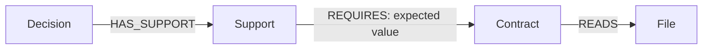

# Graph model

Each project uses a separate FalkorDB graph.
The project configuration defines contracts and their exact file dependencies.
Decisions and observations persist across agent sessions.



An assumption is a contract with an expected Boolean result.
A support requires every linked assumption.
Alternative supports use OR.
The application evaluates this formula from graph records and applicable observations.

Other records store check runs, observations, assessments, proposals, acceptances, and operation receipts.
Observations retain their revision, result, output, and check definition digest.
Receipts prevent repeated requests from repeating effects.
Source references contain full Git SHAs where applicable.

## Required traversal

Git supplies changed paths. This traversal selects affected decisions and contracts:

```cypher
MATCH (f:File)<-[:READS]-(c:Contract)<-[:REQUIRES]-(s:Support)
      <-[:HAS_SUPPORT]-(d:Decision)
WHERE f.id IN $paths
RETURN d.id, c.id, s.id, f.id
```

The returned contracts select the agent's next checks.
The returned path explains why each decision needs attention.
The application does not maintain a second file-to-decision index.

## Evidence rules

1. Prefer observations at the requested revision.
2. Otherwise, inspect ancestor observations and declared file changes.
3. Keep changed dependencies stale until a new check supplies evidence.
4. Keep failed checks unknown.
5. Keep contradictory observations unknown.
6. Preserve old observations after replacement.

An empty traversal means no modeled dependency matched.
It does not prove that a change has no effects.

The implementation keeps queries beside their operations in `src/premise/memory.py`.
Reads use `ro_query`. Values use query parameters.
The MVP does not need a shortest-path or centrality algorithm.
